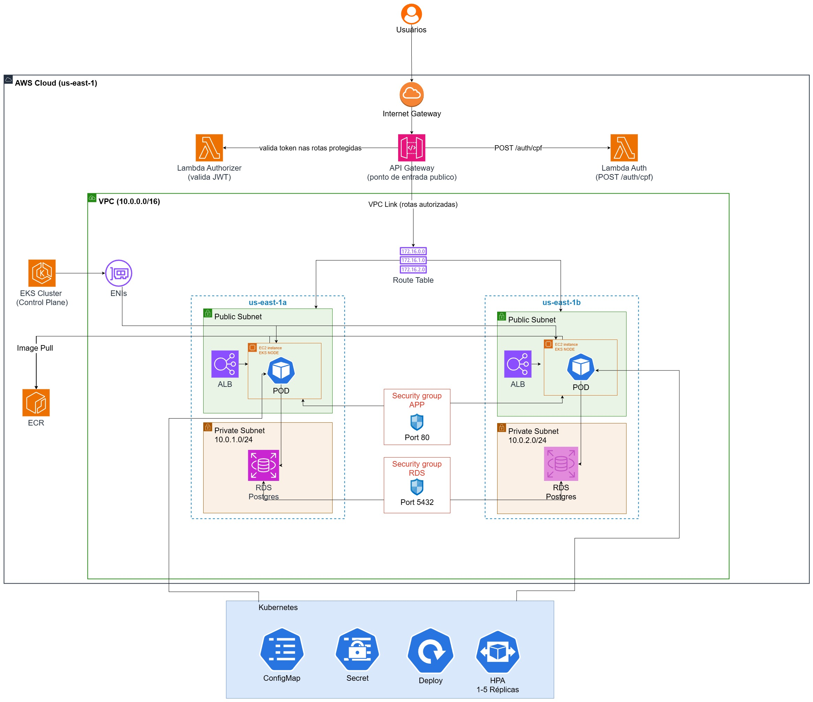
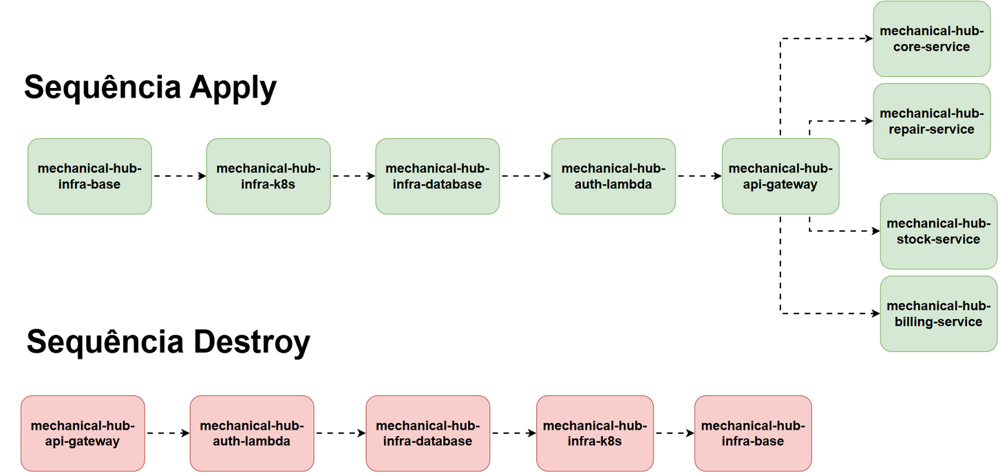
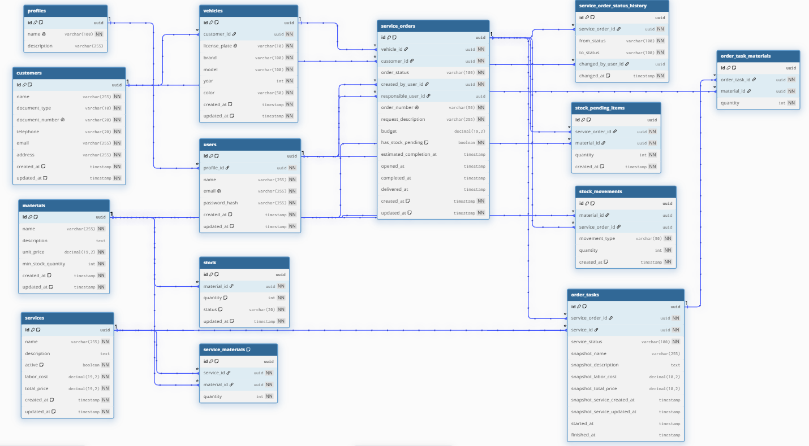

# mechanical-hub-infra-database

Provisiona **todos os bancos de dados** do projeto mechanical-hub, nas subnets
privadas e no security group já criados pelo `infra-base`: a instância RDS do
monolito (legado, Fases 1-3) e, desde a Fase 4, uma instância RDS própria por
microsserviço que usa Postgres (`core-service`, `stock-service`,
`billing-service`) mais a tabela DynamoDB do único microsserviço com banco
não-relacional (`repair-service` — ver ADR-003 no `core-service`). Critério:
todo provisionamento de banco de dados, relacional ou não, fica centralizado
aqui, independente de ser exclusivo de um serviço.

## Tecnologias

- **Terraform** (`hashicorp/aws ~> 5.0`) — instâncias RDS, tabela DynamoDB e o subnet group do banco.
- **Amazon RDS** — PostgreSQL 16, `db.t3.micro`, `gp2`, 20GB — 4 instâncias (monolito + core-service + stock-service + billing-service), cada uma com seu próprio banco/senha.
- **Amazon DynamoDB** — tabela única (`PAY_PER_REQUEST`, single-table design com GSI por `EntityType`) para o `repair-service` (order tasks + catálogo de serviços/materiais).
- **GitHub Actions** — pipelines de validação (feature) e apply/destroy (main).

## Diagrama de arquitetura



## Passos para execução e deploy

**Depende do `infra-base` já aplicado** (consome VPC, subnets privadas e o security
group `rds` via data source). Ordem completa: infra-base → infra-k8s →
**infra-database** → auth-lambda → api-gateway → `mechanical-hub` (app). Na prática,
`infra-database` e `infra-k8s` só dependem do `infra-base`, não um do outro — a
ordem entre eles é uma convenção do projeto, não uma dependência técnica. Para
derrubar, ordem inversa.



1. Configurar no repositório os secrets `AWS_ACCESS_KEY_ID`, `AWS_SECRET_ACCESS_KEY`,
   `AWS_SESSION_TOKEN`, `DB_PASSWORD` (senha do banco do monolito) e, desde a
   Fase 4, `CORE_SERVICE_DB_PASSWORD`, `STOCK_SERVICE_DB_PASSWORD` e
   `BILLING_SERVICE_DB_PASSWORD` (uma senha por banco novo).
2. Garantir que o `infra-base` já foi aplicado (VPC/subnets/SG `rds` precisam existir).
3. No início da sessão do AWS Academy, garantir `infra/pipeline.conf` com
   `DESTROY=false` e fazer merge em `main` via PR (branch protegida, sem push
   direto), ou disparar `workflow_dispatch` manualmente.
4. A pipeline aplica o Terraform e cria as 4 instâncias RDS vazias (sem nenhuma
   tabela) e a tabela DynamoDB do `repair-service`.
5. Conferir os outputs `rds_endpoint` (monolito), `core_service_rds_endpoint`,
   `stock_service_rds_endpoint`, `billing_service_rds_endpoint` e
   `repair_service_table_name`/`repair_service_table_arn` — é isso que os
   pipelines de cada microsserviço usam para montar o `DB_HOST`/`DYNAMODB_TABLE_NAME`
   dos respectivos ConfigMaps.
6. Cada aplicação, ao subir, roda suas próprias migrations Flyway automaticamente
   contra o banco vazio (18 migrations no monolito legado; cada microsserviço
   tem seu próprio conjunto, menor, específico do seu domínio).
7. Antes da sessão do AWS Academy encerrar, mudar `infra/pipeline.conf` para
   `DESTROY=true` e fazer merge em `main` via PR.

## Decisões arquiteturais relacionadas

RFCs e ADRs ficam centralizados no repo da aplicação, para não duplicar/desincronizar entre os 6 repositórios. As diretamente relevantes para este repo:

- [RFC-002 — PostgreSQL relacional para o domínio de ordens de serviço (Fase 3)](https://github.com/estefanyneres/mechanical-hub-core-service/blob/main/docs/rfcs-fase3.md)
- [RFC-007 — Ajustes no modelo relacional (Fase 3)](https://github.com/estefanyneres/mechanical-hub-core-service/blob/main/docs/rfcs-fase3.md)
- [ADR-002 — Descoberta entre repositórios via data source (Fase 3)](https://github.com/estefanyneres/mechanical-hub-core-service/blob/main/docs/adrs-fase3.md)
- [ADR-010 — Migrations Flyway no repositório da aplicação (Fase 3)](https://github.com/estefanyneres/mechanical-hub-core-service/blob/main/docs/adrs-fase3.md)
- [ADR-011 — Tabela de histórico de status (Fase 3)](https://github.com/estefanyneres/mechanical-hub-core-service/blob/main/docs/adrs-fase3.md)
- [ADR-001 — Decomposição em 4 microsserviços, por domínio de dados (Fase 4)](https://github.com/estefanyneres/mechanical-hub-core-service/blob/main/docs/adrs.md)
- [ADR-003 — Banco não-relacional: DynamoDB, só pro repair-service (Fase 4)](https://github.com/estefanyneres/mechanical-hub-core-service/blob/main/docs/adrs.md)

## Por que `monitoring_interval = 0`

O RDS Enhanced Monitoring precisa de uma IAM Role própria
(`monitoring-rds-enhanced-...`) para publicar métricas no CloudWatch. A `LabRole`
do AWS Academy não permite criar essa role, então `monitoring_interval` fica em
`0` (desabilitado) deliberadamente — não é um valor padrão esquecido, é a forma de
evitar que o `terraform apply` falhe tentando criar uma role que a conta não permite.

## Schema

Este repositório só cria os bancos **vazios** (RDS) e a tabela DynamoDB — nenhuma
migration, nenhuma tabela/schema de aplicação aqui. Cada serviço aplica seu
próprio schema sozinho, no boot (Flyway, ver ADR-010): o monolito legado roda as
18 migrations antigas; cada microsserviço novo (`core-service`, `stock-service`,
`billing-service`) roda só as migrations do seu próprio domínio, bem menores. O
`repair-service` não precisa de nenhuma migration — DynamoDB é schema-less, a
estrutura da single-table (PK/SK/GSI) já fica definida aqui no Terraform (ver
`infra/dynamodb.tf`). Isso significa que toda vez que este repo é destruído e
recriado, os bancos voltam zerados e são re-migrados do zero na subida seguinte
de cada aplicação — validado ao vivo múltiplas vezes durante o projeto.

## Modelo relacional (banco do monolito legado)

**Justificativa da escolha do banco:** PostgreSQL, via RDS — o domínio (clientes →
veículos → ordens de serviço → tarefas → materiais/estoque) tem relacionamentos
fortes, exige integridade referencial real (ex: `ON DELETE RESTRICT` impedindo
excluir um veículo com ordens vinculadas) e consistência transacional em operações
como reserva de estoque — não há requisito de escala horizontal ou schema flexível
que justificasse uma solução NoSQL (RFC-002).

**Ajustes nesta fase:** duas tabelas novas em relação à fase 2 (RFC-007):
`order_task_materials` (materiais efetivamente consumidos em cada tarefa de uma OS,
separado do catálogo padrão do serviço) e `service_order_status_history` (histórico
de transições de status, necessário para o dashboard de tempo médio por status e
para correlação com traces/logs).

**Diagrama ER** (gerado das 18 migrations):



**Relacionamentos**, organizados em cinco áreas:

- **Cadastro** — `customers` e `vehicles` (1:N, `ON DELETE RESTRICT`). `profiles` e `users` (1:N).
- **Catálogo** — `services` e `materials`, independentes entre si, ligados por `service_materials` (N:N com `quantity`, índice único em `(service_id, material_id)`).
- **Execução da OS** — `service_orders` é o centro: referencia `vehicles`, `customers` e `users` duas vezes (`created_by_user_id` obrigatório, `responsible_user_id` opcional). Se desdobra em `order_tasks` (1:N), que se desdobra em `order_task_materials` (1:N, `ON DELETE CASCADE`).
- **Estoque** — `materials` e `stock` (1:N pelo schema). `stock_movements` e `stock_pending_items` referenciam `materials` e, quando aplicável, a `service_order` de origem (`stock_movements.material_id` usa `ON DELETE SET NULL`; as demais FKs do domínio usam `RESTRICT`).
- **Auditoria** — `service_order_status_history` referencia `service_orders` (`ON DELETE CASCADE`) e `users` de forma opcional (`changed_by_user_id` nullable).

Cada microsserviço documenta seu próprio schema/migrations no respectivo
repositório — não duplicado aqui.

## Outputs publicados

| Output                         | Descrição                                      |
|----------------------------------|---------------------------------------------------|
| `rds_endpoint`                  | Endpoint do banco RDS do monolito legado (`DB_HOST`) |
| `core_service_rds_endpoint`     | Endpoint do banco RDS do core-service          |
| `stock_service_rds_endpoint`    | Endpoint do banco RDS do stock-service         |
| `billing_service_rds_endpoint`  | Endpoint do banco RDS do billing-service       |
| `repair_service_table_name`     | Nome da tabela DynamoDB do repair-service      |
| `repair_service_table_arn`      | ARN da tabela DynamoDB do repair-service       |

## Pipelines

- `pipeline-infra-feature.yml`: dispara em push para `feature/*`. Roda
  `terraform fmt -check`, `init -backend=false` e `validate`. Abre PR automático
  para `main` se tudo passar.
- `pipeline-infra-main.yml`: dispara em push para `main` (ou `workflow_dispatch`).
  Lê `infra/pipeline.conf` e aplica ou destrói o Terraform conforme `DESTROY`,
  passando `db_password`, `core_service_db_password`, `stock_service_db_password`
  e `billing_service_db_password` via `-var`.

## Estrutura

```
mechanical-hub-infra-database/
├── .github/workflows/
│   ├── pipeline-infra-feature.yml
│   └── pipeline-infra-main.yml
├── docs/
│   └── desenhos/
│       ├── mechanical-hub-infraestrutura-fase-03.jpg
│       ├── mechanical-hub-apply-destroy-repos-fase-03.jpg
│       ├── mechanical-hub-apply-destroy-repos-fase-04.png
│       └── diagrama-entidade-relacionamento-fase-03.png
├── infra/
│   ├── providers.tf
│   ├── variables.tf
│   ├── data.tf
│   ├── rds.tf
│   ├── rds-microservices.tf
│   ├── dynamodb.tf
│   ├── outputs.tf
│   └── pipeline.conf
├── .gitignore
└── README.md
```
