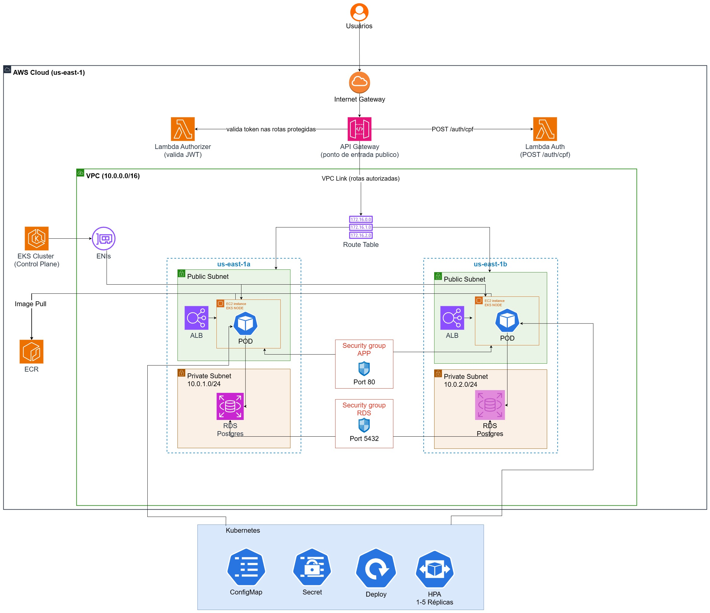
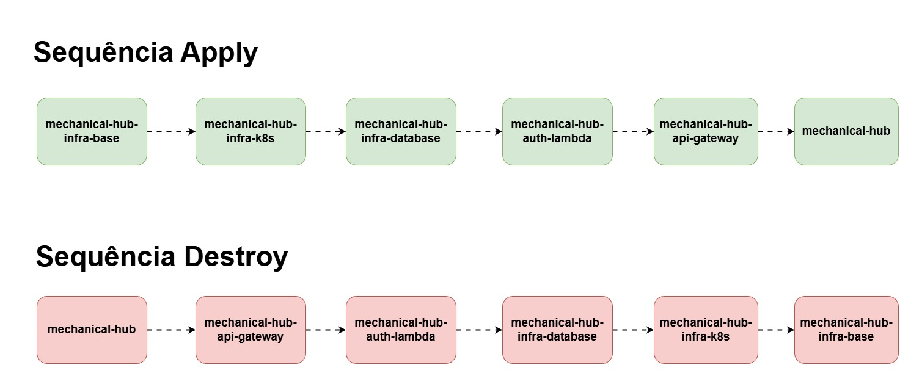
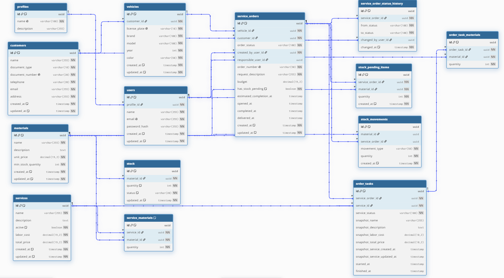

# mechanical-hub-infra-database

Provisiona a instância RDS PostgreSQL (vazia, sem schema) do projeto mechanical-hub,
nas subnets privadas e no security group já criados pelo `infra-base`.

## Tecnologias

- **Terraform** (`hashicorp/aws ~> 5.0`) — instância RDS e o subnet group do banco.
- **Amazon RDS** — PostgreSQL 16, `db.t3.micro`, `gp2`, 20GB.
- **GitHub Actions** — pipelines de validação (feature) e apply/destroy (main).

## Diagrama de arquitetura



## Passos para execução e deploy

**Depende do `infra-base` já aplicado** (consome VPC, subnets privadas e o security
group `rds` via data source). Ordem completa: infra-base → infra-k8s →
**infra-database** → auth-lambda → api-gateway → `mechanical-hub` (app). Na prática,
`infra-database` e `infra-k8s` só dependem do `infra-base`, não um do outro — a
ordem entre eles é uma convenção do projeto, não uma dependência técnica. Para
derrubar, ordem inversa.



1. Configurar no repositório os secrets `AWS_ACCESS_KEY_ID`, `AWS_SECRET_ACCESS_KEY`,
   `AWS_SESSION_TOKEN` e `DB_PASSWORD` (senha do usuário administrador do banco).
2. Garantir que o `infra-base` já foi aplicado (VPC/subnets/SG `rds` precisam existir).
3. No início da sessão do AWS Academy, garantir `infra/pipeline.conf` com
   `DESTROY=false` e fazer merge em `main` via PR (branch protegida, sem push
   direto), ou disparar `workflow_dispatch` manualmente.
4. A pipeline aplica o Terraform e cria a instância RDS vazia (sem nenhuma tabela).
5. Conferir o output `rds_endpoint` — é ele que o pipeline do `mechanical-hub`
   usa para montar o `DB_HOST` do ConfigMap da aplicação.
6. A aplicação (`mechanical-hub`), ao subir, roda as 18 migrations Flyway
   automaticamente contra o banco vazio.
7. Antes da sessão do AWS Academy encerrar, mudar `infra/pipeline.conf` para
   `DESTROY=true` e fazer merge em `main` via PR.

## Decisões arquiteturais relacionadas

RFCs e ADRs ficam centralizados no repo da aplicação, para não duplicar/desincronizar entre os 6 repositórios. As diretamente relevantes para este repo:

- [RFC-002 — PostgreSQL relacional para o domínio de ordens de serviço](https://github.com/estefanyneres/mechanical-hub/blob/main/src/docs/fase3/documentacao/rfcs.md)
- [RFC-007 — Ajustes no modelo relacional nesta fase](https://github.com/estefanyneres/mechanical-hub/blob/main/src/docs/fase3/documentacao/rfcs.md)
- [ADR-002 — Descoberta entre repositórios via data source](https://github.com/estefanyneres/mechanical-hub/blob/main/src/docs/fase3/documentacao/adrs.md)
- [ADR-010 — Migrations Flyway no repositório da aplicação](https://github.com/estefanyneres/mechanical-hub/blob/main/src/docs/fase3/documentacao/adrs.md)
- [ADR-011 — Tabela de histórico de status](https://github.com/estefanyneres/mechanical-hub/blob/main/src/docs/fase3/documentacao/adrs.md)

## Por que `monitoring_interval = 0`

O RDS Enhanced Monitoring precisa de uma IAM Role própria
(`monitoring-rds-enhanced-...`) para publicar métricas no CloudWatch. A `LabRole`
do AWS Academy não permite criar essa role, então `monitoring_interval` fica em
`0` (desabilitado) deliberadamente — não é um valor padrão esquecido, é a forma de
evitar que o `terraform apply` falhe tentando criar uma role que a conta não permite.

## Schema

Este repositório só cria a instância RDS vazia — nenhuma migration, nenhuma tabela.
O schema completo (18 migrations Flyway) vive em `mechanical-hub` e é aplicado
automaticamente no boot da aplicação (ver ADR-010). Isso significa que toda vez
que este repo é destruído e recriado, o banco volta zerado e é re-migrado do zero
na subida seguinte da aplicação — validado ao vivo múltiplas vezes durante o projeto.

## Modelo relacional

**Justificativa da escolha do banco:** PostgreSQL, via RDS — o domínio (clientes →
veículos → ordens de serviço → tarefas → materiais/estoque) tem relacionamentos
fortes, exige integridade referencial real (ex: `ON DELETE RESTRICT` impedindo
excluir um veículo com ordens vinculadas) e consistência transacional em operações
como reserva de estoque — não há requisito de escala horizontal ou schema flexível
que justificasse uma solução NoSQL (RFC-002).

**Ajustes nesta fase:** duas tabelas novas em relação à fase 2 (RFC-007):
`order_task_materials` (materiais efetivamente consumidos em cada tarefa de uma OS,
separado do catálogo padrão do serviço) e `service_order_status_history` (histórico
de transições de status, necessário para o dashboard de tempo médio por status e
para correlação com traces/logs).

**Diagrama ER** (gerado das 18 migrations):



**Relacionamentos**, organizados em cinco áreas:

- **Cadastro** — `customers` e `vehicles` (1:N, `ON DELETE RESTRICT`). `profiles` e `users` (1:N).
- **Catálogo** — `services` e `materials`, independentes entre si, ligados por `service_materials` (N:N com `quantity`, índice único em `(service_id, material_id)`).
- **Execução da OS** — `service_orders` é o centro: referencia `vehicles`, `customers` e `users` duas vezes (`created_by_user_id` obrigatório, `responsible_user_id` opcional). Se desdobra em `order_tasks` (1:N), que se desdobra em `order_task_materials` (1:N, `ON DELETE CASCADE`).
- **Estoque** — `materials` e `stock` (1:N pelo schema). `stock_movements` e `stock_pending_items` referenciam `materials` e, quando aplicável, a `service_order` de origem (`stock_movements.material_id` usa `ON DELETE SET NULL`; as demais FKs do domínio usam `RESTRICT`).
- **Auditoria** — `service_order_status_history` referencia `service_orders` (`ON DELETE CASCADE`) e `users` de forma opcional (`changed_by_user_id` nullable).

## Outputs publicados

| Output          | Descrição                          |
|------------------|--------------------------------------|
| `rds_endpoint`   | Endpoint do banco RDS (`DB_HOST`)   |

## Pipelines

- `pipeline-infra-feature.yml`: dispara em push para `feature/*`. Roda
  `terraform fmt -check`, `init -backend=false` e `validate`. Abre PR automático
  para `main` se tudo passar.
- `pipeline-infra-main.yml`: dispara em push para `main` (ou `workflow_dispatch`).
  Lê `infra/pipeline.conf` e aplica ou destrói o Terraform conforme `DESTROY`,
  sempre passando `db_password` via `-var` a partir do secret `DB_PASSWORD`.

## Estrutura

```
mechanical-hub-infra-database/
├── .github/workflows/
│   ├── pipeline-infra-feature.yml
│   └── pipeline-infra-main.yml
├── docs/
│   └── desenhos/
│       ├── mechanical-hub-infraestrutura-fase-03.jpg
│       ├── mechanical-hub-apply-destroy-repos-fase-03.jpg
│       └── diagrama-entidade-relacionamento-fase-03.png
├── infra/
│   ├── providers.tf
│   ├── variables.tf
│   ├── data.tf
│   ├── rds.tf
│   ├── outputs.tf
│   └── pipeline.conf
├── .gitignore
└── README.md
```
